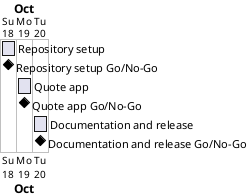

# Project Plan

## Metadata
| Key | Value |
| --- | --- |
| ID | PP-001 |
| CrossReference | [BC-001], [SA-001], [MIL-001], [MIL-002], [MIL-003] |
| Language | en |
| Domain | it |

## Version History
| Date | Status | Author | Reviewer | Change | Commit |
| --- | --- | --- | --- | --- | --- |
| 2026-10-18 | Accepted | Jens Tirsvad Nielsen | AI as stand-in for S01 | Initial version | pending |

---

## Purpose

Schedule the three gateways that take the Kanye Quotes assignment from an empty repository to a documented, shareable project, within the Business Case's effort of about one day of author time.

## Planning Assumptions

- The plan starts on 2026-10-18 and ends by 2026-10-20.
- Phase length: one day per gateway. Each gateway is one branch and one pull request.
- S01 owns and reviews every gateway ([SA-001]).

## Gateway Schedule

| Gateway | Document | Window | Decision date | Owner | Stories | Main deliverable | Milestone |
| --- | --- | --- | --- | --- | --- | --- | --- |
| Repository setup | [MIL-001] | 2026-10-18 | 2026-10-18 | S01 | none | Repository metadata, configuration, skeleton, ADR | |
| Quote app | [MIL-002] | 2026-10-19 | 2026-10-19 | S01 | UC-001 | The tested tkinter app | |
| Documentation and release | [MIL-003] | 2026-10-20 | 2026-10-20 | S01 | none | README, screenshots, wiki in en, da, ms | |



## Scope Coverage

| Business Case scope item | Gateway |
| --- | --- |
| tkinter app, API call, quote display, error handling | MIL-002 |
| `src/`, `tests/`, `docs/`, `pyproject.toml`, `constants.py`, `.gitignore`, `Doxyfile` | MIL-001 |
| Doxygen comments | MIL-002 |
| README with venv, pip, run and test instructions | MIL-003 |
| Wiki in en, da, ms and screenshots | MIL-003 |
| Repository description and topics | MIL-001 |

## Dependencies

```
MIL-001 → MIL-002 → MIL-003
```

A No-Go on a gateway moves every later gateway by the days needed to fix and re-review it.

## Plan Risks

| Risk | Impact | Mitigation |
| --- | --- | --- |
| Screenshots cannot be captured without a display | MIL-003 slips | Capture on the author's Windows desktop with the running app |
| The git host token lacks the scope to edit repository settings | MIL-001 task 1 cannot finish | Stop and report; S01 sets description and topics by hand |
| Pull request checks are red | A gateway cannot merge | Fix the cause; stop after three attempts as `AGENTS.md` says |

## Open Issues

- The prompt names `https://git.tirsystem.com/Tirsvad-Udemy-100_days_of_code`; the clone's `origin` is `Tirsvad-Udemy-100-days-of-code/033-kanye-quotes`. The plan targets `origin` for the description, topics, issues and pull requests.
- The assignment uses `requests`; the plan uses `urllib` to have no runtime dependency (ADR-0001 in MIL-001).
- `.env` also holds `GITHUB_*` values; the plan does not use them (no GitHub mirror is planned).

---

[BC-001]: ./business-case.md
[SA-001]: ./stakeholder-analysis.md
[MIL-001]: ./milestones/mil-001-repository-setup.md
[MIL-002]: ./milestones/mil-002-quote-app.md
[MIL-003]: ./milestones/mil-003-documentation-release.md
