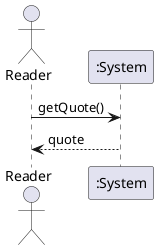
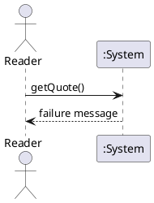

# System Sequence Diagram

## Metadata
| Key | Value |
| --- | --- |
| ID | SSD-001 |
| CrossReference | [UC-001] |
| Language | en |
| Domain | it |

## Version History
| Date | Status | Author | Reviewer | Change | Commit |
| --- | --- | --- | --- | --- | --- |
| 2026-10-18 | Accepted | Jens Tirsvad Nielsen | AI as stand-in for S01 | Initial version | [3b6e9ba] |

---

## Source Use Case

Read a New Kanye Quote ([UC-001]) — scenario: main success scenario. The quote failure (extension 2a) is the second diagram below.

## Diagram

Extension 2a, quote failure:

## System Operations

| Step | Message | Parameters | Return | Use case step |
| --- | --- | --- | --- | --- |
| 1 | getQuote | none | quote (text), or a failure message in extension 2a | 1 (ask), 3 (show); step 2 is internal to the System |

## Lifecycle Notes

The System instance lives as long as the window is open; it keeps no state between calls except the quote shown.

---

[UC-001]: ./uc.md
[3b6e9ba]: https://git.tirsystem.com/Tirsvad-Udemy-100-days-of-code/033-kanye-quotes/commit/3b6e9ba1e8dd0e88c0013b213013e532657aff7a
