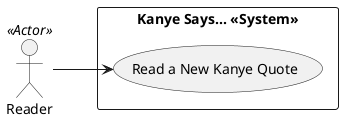

# Use Case Diagram

## Metadata
| Key | Value |
| --- | --- |
| ID | UCD-001 |
| CrossReference | [SA-001], [BC-001], [US-001], [UC-001] |
| Language | en |
| Domain | it |

## Version History
| Date | Status | Author | Reviewer | Change | Commit |
| --- | --- | --- | --- | --- | --- |
| 2026-10-18 | Accepted | Jens Tirsvad Nielsen | AI as stand-in for S01 | Initial version | pending |

---

## Purpose and Scope

The system boundary is the Kanye Says... desktop app. Inside it the reader asks for a quote and sees it. The quote source, the Kanye Rest API, is outside the boundary and is not modelled as an actor.

## Diagram

## Actor Table

| Actor | Stereotype | Stakeholder ID (SA) | Goals (use cases) |
| --- | --- | --- | --- |
| Reader | `<<Actor>>` | S01, S02 | Read a New Kanye Quote |

## Use Case Table

| Use Case | Actor(s) | Goal |
| --- | --- | --- |
| Read a New Kanye Quote | Reader | See a different Kanye West quote each time the reader asks |

## Relationships

| From | Relationship (`<<include>>` / `<<extend>>`) | To | Justification |
| --- | --- | --- | --- |
| none | none | none | One use case; the failure case is an extension flow of the use case, not a separate use case |

---

[SA-001]: ./stakeholder-analysis.md
[BC-001]: ./business-case.md
[US-001]: ./user-stories.md
[UC-001]: ./uc-001/uc.md
